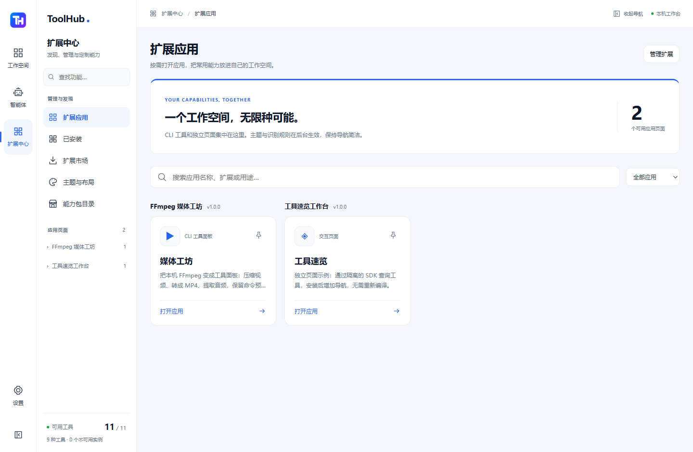
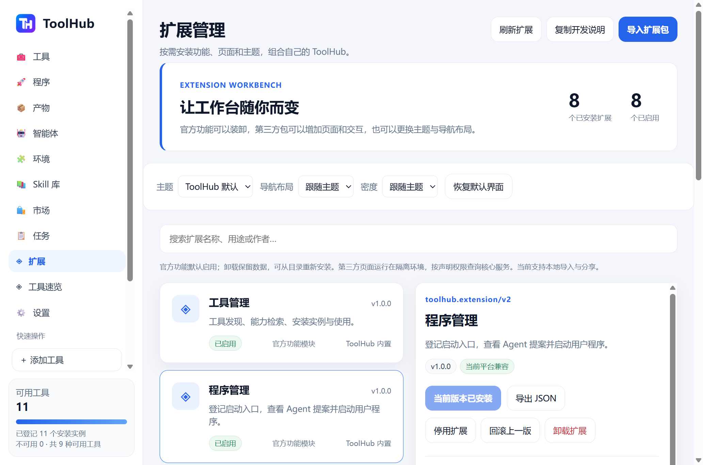
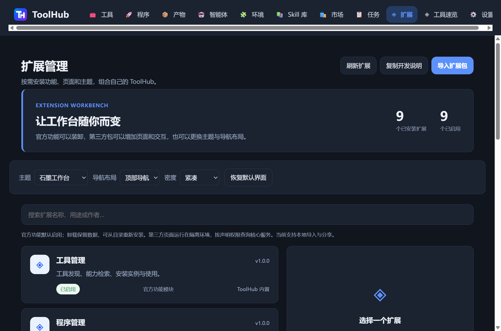

# ToolHub 扩展工作台 / Extension workbench

ToolHub 的工具、程序、产物、环境、Skill、能力包市场和任务页现在是七个默认启用的官方功能扩展。智能体接入、权限、数据存储、执行与审计、扩展管理和恢复入口保留在内核。已启用扩展的页面进入二级导航，官方页面按需加载；扩展管理不会随市场模块一起卸载。

## 两级导航（beta.6）

一级固定为工作空间、智能体、扩展中心和设置，由内核维护；安装扩展不增加一级入口。

- 工作空间：工具、程序、产物、环境、Skill 库、任务，以及最多 8 个用户固定的扩展页面。
- 智能体：已接入智能体、接入说明。
- 扩展中心：扩展应用、已安装、扩展市场、主题与布局，以及可选的能力包目录。扩展市场仍是内置和本地导入目录，社区按钮打开公开仓库，不自动下载。
- 设置：现有通用设置、权限、启动与存储管理。

CLI 和 views 默认进入扩展应用目录，二级栏按扩展包折叠组织，可搜索名称和页面，并通过图钉固定到工作空间。主题、识别规则、仅 Skill 的包不产生页面入口。多页面仍使用原有 view.id；navigation.order 只影响二级功能排序，不提供一级栏控制权，也不新增包字段或权限。

固定项、各组最近页面和折叠状态保存在本机 WebView 的 localStorage（th.navigation.v1），不进入数据库或配置导出；清除 WebView 数据会恢复默认。停用扩展隐藏固定项，重新启用后恢复；卸载清除对应固定项。已失效页面回到扩展管理；全部可选模块关闭后，核心接入、设置与恢复仍然可用。左/右/顶部位置、主题色与密度继续生效；窄窗口使用可收起的二级浮层。

下图来自 Windows 原生隔离验收实例，展示两个示例扩展；尚未随 beta.5 GitHub 安装包发布。



## 使用

- **扩展**：选择功能后启用、停用或卸载。停用后导航消失，对应模块查询接口返回 unavailable；原有数据保留，重新启用/安装后可继续使用。已批准执行与任务结果、权限和审计属于内核，不通过页面停用伪造或放宽授权。
- **导入扩展包**：先选择 `.toolhub-extension.json`，核对内容、版本、平台、权限和依赖后安装。当前为本地目录/示例，不提供在线自动下载。
- **编辑扩展**：修改 JSON、校验预览、确认安装更新。自动填写下一 patch 版本；有 recognition 时必须同步其 version。上一版可以回滚，也可导出 JSON 分享。导入的本地修改只在用户再次确认更新时才会被替换。
- **外观**：安装石墨示例后点击“应用主题”，也可选择主题、左/右/顶部导航、宽松/紧凑密度。内核提供“恢复默认界面”；当前主题停用/卸载后自动回退，保留偏好以便重新启用。
- **工具速览**：安装示例后增加导航，页面脚本通过 SDK 查询本机工具。这是独立可修改的 HTML/CSS/JavaScript 页面，不需要重编译宿主。

首次迁移只安装一次官方功能包。已被用户停用或卸载的官方包不会在重启时偷偷恢复。官方包可从随包目录重新安装。产物扩展停用/卸载会取消已有清理倒计时，保留产物并标为 blocked；恢复模块后需要重新核对安排，不能立即执行过期倒计时。

## v1 与 v2

旧 `toolhub.extension/v1` 识别规则/通用 Skill 包保持兼容，新可选字段不加入旧快照的序列化和摘要。`toolhub.extension/v2` 还支持如下贡献：

| 字段 | 功能 |
| --- | --- |
| views | 最多 8 个导航页面，每项 id/label/icon/order/html/css/script；id 以包 id + 点号开头 |
| theme | 受限颜色变量、layout、density、sidebar_width、radius；不插入任意宿主 CSS |
| permissions | 页面可申请 tools.read、programs.read、programs.propose、skills.read、environments.read、tasks.read |
| dependencies | 最多 16 项 id/min_version；依赖必须已启用、版本满足，禁止环；停用依赖前先停用依赖它的包 |
| recognition / skills | 保留已有资源与可跨宿主复用的指令契约，不安装工具依赖或授予执行信任 |
| host_module / navigation | 保留给 toolhub.builtin.* 官方模块；只引用宿主提供的确定模块，可以定制导航标签/图标/顺序，不允许夹带第三方页面代码 |

权威实现为 `crates/skills/src/extension.rs`，对外格式为 `schemas/extension.schema.json`。示例在 `extensions/examples/`，官方清单在 `extensions/official/`，SDK 在 `extensions/sdk/`。最小宿主版本、语义版本和平台声明必须真实；声明不等于平台验证。

总包最大 256 KiB，安装数量上限 32（包括 7 个官方包）。每页 HTML 64 KiB、CSS 32 KiB、JS 64 KiB；最多 32 条识别规则、64 个能力和 8 个 Skill。禁止未知字段、安装钩子、原生库、目录穿越与宿主专属 Skill。所有资源以完整快照存入 SQLite，来源名称和作者字符串不是签名。

## 页面 SDK

```js
// 先声明 permissions: ["tools.read"]。仅查询选中用途，不列举全部能力正文。
const tools = await toolhub.call('registry.search', {query: 'FFmpeg', limit: 5});
await toolhub.notify(`找到 ${tools.length} 个候选`);
await toolhub.navigate('tools'); // 只能导航到当前已启用页面
```

全局 `toolhub` 提供 Promise 接口：call(method, params)、notify(message)、navigate(page)。查询方法保留原生 THP 参数和返回值；页面需要自行分页/限制输出。该接口不是新 MCP server，Agent 仍使用固定的 16 个元工具与默认 5 条摘要。

beta.6 新增可选的显示状态接口 `toolhub.storage.get()` → `{revision,data}`、`toolhub.storage.set(data,expectedRevision)` → 新快照。它是包专属的父 WebView localStorage，不是 THP 方法；最大 32 KiB UTF-8 数据，不接受包 ID、磁盘路径或后端设置名。每次读取/写入前重新核对包仍已启用且摘要相同，写入修订号不符则拒绝。清除 WebView 数据会重置；卸载保留，重新安装相同包 ID 可恢复。旧页面 SDK 保持兼容，不新增本机执行、网络或文件权限。需要此功能的包应声明 min_toolhub_version ≥ 0.3.0-beta.6；并发保存要串行处理并使用最新 revision。设计台的实际用法见 [设计台](DESIGN-STUDIO.md)。

beta.7 增加显示接口 `toolhub.presentation.set(true/false)` 和宿主管理的 `toolhub:presentation` 事件 `{expanded}`。同一隔离 iframe 可以暂时覆盖整个工作台；宿主保留固定返回栏，背景暂停交互，退出/导航/卸载时恢复。进入时核对来源、token、当前已启用包和摘要；参数必须为布尔值。此接口不调用浏览器/操作系统全屏，不增加文件、网络、执行或原生窗口权限，CSP 与 sandbox 不变。需要此接口的包声明 min_toolhub_version ≥ 0.3.0-beta.7。

| 页面权限 | 可调用方法 |
| --- | --- |
| tools.read | registry.search、registry.inspect_tool、registry.inspect_instance、resolve.capability、capability.list |
| programs.read | program.search：只查询允许共享的元数据 |
| programs.propose | program.propose：只进入用户待确认列表 |
| skills.read | skill.list、skill.inspect、skill.resolve |
| environments.read | environment.list |
| tasks.read | execute.list、execute.status；仍执行任务拥有者检查 |

页面不直接获得桌面选择、程序启动、文件访问、扩展安装、策略修改、执行或产物删除接口。需要这些功能时跳转官方页面，由用户和原有核心策略处理。查询结果和包正文不构成额外授权。

## 页面隔离

仅在打开扩展页面时，桌面端启动绑定 127.0.0.1 随机端口的文档服务。它只为内核已发放的随机会话提供 index.html/view.css/view.js，不接受磁盘路径、目录浏览或 RPC；每次资源读取核对当前包和摘要，最多 32 会话、8 个连接。

该来源属于 Tauri 远程页面，未分配原生命令权限。iframe 与响应 CSP 都设置 sandbox allow-scripts，未设置 allow-same-origin、弹窗或顶层导航。页面有自己的 CSP，脚本和样式仅可读取当前随机会话的固定资源。fetch/XHR、子框架、表单提交和外部图片不开放；主应用原有脚本 CSP 保持不变。桥核对窗口来源、会话 token、当前包摘要及声明权限，限制并发和请求大小；daemon 强制按 extension:id 普通身份执行，不能继承桌面 controller。

这是一种受限的前端扩展运行方式，不声称提供完整操作系统沙箱。任意本机后台插件、独立进程钩子和 Rust 动态库不在本版接口中；官方原生服务实现仍随宿主编译、由扩展生命周期控制。第三方可以独立编写页面逻辑、主题、规则与 Skill，不能通过 JSON 替换核心权限或原生业务实现。

## THP 与生命周期

| 方法 | 参数 | 权限 |
| --- | --- | --- |
| extension.list | {} | 只读安装快照和启用状态 |
| extension.preview | {package} | 只读校验，摘要、兼容性、冲突和 Skill 依赖 |
| extension.install | {package,digest,expected_digest?,source?} | 已验证桌面 controller；更新必须更高版本 |
| extension.set_enabled | {id,enabled,expected_digest} | controller；停用前检查依赖 |
| extension.rollback | {id,expected_digest} | controller；重新校验依赖和前一快照 |
| extension.remove | {id,expected_digest} | controller；移除包，保留用户记录和原文件 |
| extension.preferences | {} 或 {settings:{theme_id?,layout?,density?}} | 查询只读，写入 controller；{} settings 恢复默认 |
| extension.invoke | {id,expected_digest,method,params?} | 有限页面桥；从不取得 controller |

更新、启停、回滚和卸载提升授权 revision，旧执行凭证失效。扫描/执行期间拒绝修改扩展，先完成或取消当前操作。移除识别规则会使原实例不可用，保留 provenance；重新安装需重新扫描。卸载不删除 OS 软件、普通 Skill、程序和产物记录。包快照不做静默自动更新。

本机测试使用独立 Windows 注册表和真实 Tauri WebView；macOS 新页面服务器和导航生命周期尚未进行原生验收。降级到不支持 v2 的旧本地开发版本时，应先关闭新程序并恢复升级前数据库备份，不能让旧 v1 解析器读取新模块快照。

## Windows acceptance — 2026-10-13

- Rust workspace: 222 passed, 1 existing ignored; TypeScript SDK: 4 passed and strict types checked; desktop UI: type check and production build passed.
- Packaged Tauri/CDP: 11 native behavior groups passed, including default modules, install/disable/remove/reinstall, local edits/rollback, independent JavaScript and query bridge, appearance/reset, all modules disabled together, 16-tool MCP with five-summary search, and all ten first-party/kernel pages.
- Desktop and paired daemon restart: 5 persistence groups passed. Disabled environment stayed disabled, removed market was not reseeded, program rows and digests stayed unchanged, high-priority artifact files survived, and Agent/settings/recovery remained reachable.
- Browser isolation: parent DOM and network blocked; SDK management denied; attempted direct native settings write did not change kernel preferences (WebView2 did not deliver a response in the sandbox). Top navigation uses one horizontal row and leaves at least 75% of the viewport for content; right layout leaves over 60% width for content.
- Evidence kept locally under `D:\codex\toolhub-workbench-20261013`; sample launch files were never executed and cleanup was never scheduled.





Connection-recovery repair: a real isolated daemon was stopped and temporarily renamed, the Agent refresh produced a connection banner, then the original helper was restored and “Retry connection” cleared the banner and reloaded tools. The final local package is `workbench-20261013-6`; its CLI/daemon hashes match the full Rust/native acceptance, with a focused desktop recovery check after the last UI-only repair.


## beta.4：声明式 CLI 面板

`extensions/examples/ffmpeg.toolhub-extension.json` 是第一个真实 CLI 面板。安装后增加“媒体工坊”，包括压缩视频、H.264/AAC MP4 转换和 M4A 音频提取，附 Agent 可查询的通用流程。它不包含 FFmpeg 二进制；需要本机可用且已核对信任的 FFmpeg。示例依赖 libx264/AAC，部分构建缺少编码器时会返回错误；不自动下载或静默改用另一份程序。默认不覆盖已有输出，CRF 不保证体积一定缩小。

v2 新增可选 `cli`：`{id,label,icon,order,tool_definition,actions}`。`cli.id` 使用包前缀且不能与 views 重复；最多 8 个 action。action 包含 `id,label,description,parameters,args,timeout_ms`，ID 为 1–48 个小写字母/数字/下划线，最长 300000 ms。包的 `min_toolhub_version` 至少 0.3.0-beta.4；旧快照缺少 cli 时不改变序列化摘要。

每个 action 必须且只能有一个 `input_file` 和一个 `output_file`，可另加有限 `choice`，合计最多 8 个参数。文件参数声明非空后缀列表，不预置本机路径；choice 声明有限 label/value 和有效 default。args 是最多 128 个字符串组成的参数数组，`{input}` 等占位符必须独占一个参数且对应声明；不进行 shell 解析、字符串插值或环境替换。参数只能替换成一个 argv 元素，空格、中文、引号和 & 保持为路径数据。静态参数本身仍需要像代码一样审核；核心不声称沙箱化任意 CLI 的文件/网络行为。

核心原生表单负责文件选择、工具实例、命令预览和一次执行确认；CLI 贡献本身在安装预览中展示写入及执行影响。此权限不会加入 iframe 的 bridge。`extension.cli_preview`、`extension.cli_start` 是 controller-only THP 接口，不能从 `extension.invoke` 调用，Agent 也不能伪造 controller。普通 Agent 通过包附带的 Skill 和现有 execute_tool 使用本机程序，遵守自身任务授权、信任和策略；MCP 仍为 16 个固定工具。

| THP 方法 | 参数 / 行为 |
| --- | --- |
| extension.cli_preview | `{id,expected_digest,action_id,instance_id,values}`；确认已启用包、摘要、动作、工具 definition_id、参数全集、真实本地输入和未存在输出，返回准确 executable/argv/cwd/output/trust/supported |
| extension.cli_start | 相同参数加 `{confirmation:完整预览对象}`；重新生成并逐项比较预览，再为准确请求发放单次许可、按 extension:id 普通主体准备身份绑定后台任务 |

输出文件不能已存在（包括链接），目录必须已存在且有效；拒绝相对路径、URL、上级穿越，Windows 额外拒绝设备/网络路径、备用数据流和保留文件名。FFmpeg 示例另使用 `-nostdin -n -protocol_whitelist file,pipe`，限制输入协议并防止覆盖竞争。执行核心仍检查工具信任、策略、可执行文件哈希、固定身份、输出声明和超时。包启停/更新提升授权 revision；已有扫描或执行期间仍拒绝改包，先完成/取消任务。

面板用现有后台任务接口读取本扩展拥有的任务，显示状态/耗时，原生取消按钮复用核心取消机制。结束后可以查看限量日志和定位实际输出；当前没有百分比/逐行直播日志。失败/取消可能留下不完整文件，保留由用户处理。任务状态跨 daemon 重启保留，stdout/stderr 仅在当前服务内存保存。

Windows 原生执行需要对应 beta.4 宿主；macOS 可预览/复制流程，仍不提供身份绑定执行，实体 Mac 的新选择器未验收。Linux 无桌面发布承诺。独立扩展目录与宿主代码可分开发版；安装扩展从不替换核心二进制或调整 MCP 连接。


## Editable presets and document export (beta.8)

`toolhub.storage` retains its package namespace/revision semantics and now permits 1 MiB UTF-8 JSON (previously 32 KiB). Clearing the WebView profile still removes this state; export important data. `await toolhub.files.exportText(name, text)` opens a native Save dialog and returns true after a successful write, false on cancel. Filenames must be plain .md/.json/.txt names (no paths, controls or alternate streams); content is limited to 2 MiB UTF-8. The iframe cannot select a destination or read its path. Source/token/current enabled package and digest are checked; native code rechecks after the dialog. Only one export request per mounted frame may be pending. The SDK waits up to five minutes for this user dialog. Sandbox/CSP and execution/network permissions stay unchanged. Require min_toolhub_version >= 0.3.0-beta.8 and feature-detect toolhub.files. Import may use a user-selected browser File input; never execute imported content.

## Bounded photo copies (beta.9)

`toolhub.images` stores only JPEG display copies in the parent WebView IndexedDB, scoped to the calling package after source/token/current enabled digest checks. `list()` returns `{revision,images,bytes,limit}` metadata; `get(id,'wall'|'display')` returns `{id,dataUrl}`; `add({name,width,height,wallWidth,wallHeight,display,wall},revision)` returns `{id,revision,duplicate}`; `remove(id,revision)` returns `{revision}`. Display/wall are JPEG data URLs, validated against actual JPEG dimensions and byte limits. IDs are content hashes, not filenames or paths. Adds/removals are atomic and revision checked; duplicates preserve existing records and revision.

Limits: 50 copies / 32 MiB per package, 128 MiB aggregate; display at most 1920 pixels per side / 768 KiB; wall at most 768 pixels per side / 128 KiB. Metadata and pixels are separate stores so list does not load the album. The child selects files with its browser File input and compresses copies locally; no native file read/path, original deletion, remote content or new execution authority is provided. CSP remains data-image only. Require beta.9 and feature-detect toolhub.images. Uninstall retains the namespace; explicitly removing an image removes its stored copies. Clearing the WebView profile removes all copies, so keep original photographs independently. This data is not part of registry/settings JSON backups.
