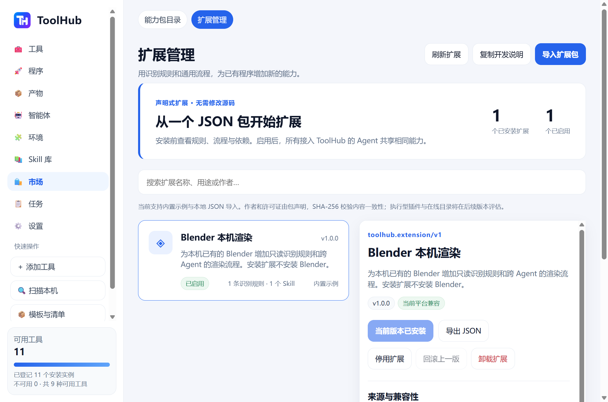

# ToolHub 声明式扩展 / Declarative extensions

第一阶段扩展把已有的工具识别资源与通用 Skill 放到一个 JSON 包里。安装扩展后无需重编译应用，新的识别规则加入原生扫描，Skill 加入所有客户端共用的查询入口。扩展包不会下载或安装其工具依赖。

市场 → **扩展管理**：选择 Blender 示例或导入 `.toolhub-extension.json`，核对作者声明、版本、SHA-256、规则、流程与依赖，然后点击确认安装。工具未在 PATH 中时，在工具页选择其目录扫描。新的识别实例保留未知信任，由用户核对后按原有策略执行。扩展安装本身不会运行程序或 Skill。

截图来自 Windows 本地测试版的隔离注册表；生产配置不自动安装任何示例。

## Contract and developer workflow

The authoritative parser is `toolhub_skills::extension::ExtensionPackage`. The public schema is `schemas/extension.schema.json`; the complete, editable example is `extensions/examples/blender.toolhub-extension.json`. The example is embedded in the desktop catalog and also included in native package assets. Create a new JSON package from this template, validate its metadata with `extension.preview`, and hand the file to the user for desktop import. No ToolHub source edit or rebuild is needed for the new package.

- `schema`: `toolhub.extension/v1`; stable dotted `id`, name, description, author and license; immutable version content. Updates must advance the semantic version.
- `platforms`: windows/macos/linux; `min_toolhub_version` is checked against the current core. Scope portability honestly; a declaration does not prove native verification.
- Optional `recognition`: the existing `toolhub.resource/v1` contract, kind recognition, same version as the enclosing package, up to 32 tool rules and 64 capabilities. Matching uses exact case-insensitive basenames and optional path-substring constraints. Existing native recognition has priority. Filenames colliding with built-in rules, installed extensions or active legacy resources are rejected.
- Optional `skills`: up to 8 existing `toolhub.bundle/v1` portable instruction bundles. Fully declared inputs, outputs, platform support and permissions are required. Host-exclusive APIs and executable Skill kinds are rejected. `SKILL.md` is embedded instruction text, not a file loaded from a package-provided path.
- Every tool definition ID and Skill ID must start with the package ID followed by a dot. Duplicate IDs and user-library conflicts are rejected. At least one rule or Skill is required.
- Maximum complete package: 256 KiB; individual Skill bundles retain their existing bounds. Unknown JSON fields, hooks, arbitrary payloads and path traversal are rejected. Runtime dependency installation, shell hooks and automatic probes are unsupported.

Platform-specific filename discovery uses the existing scanner. PATH and explicitly selected directory scans are supported; a rule does not silently grant new disk roots or scan the whole disk. Blender on macOS can be scanned at `Blender.app/Contents/MacOS` using a selected directory; it need not be installed by ToolHub.

The market's **导出 JSON** creates a portable shareable file; **复制开发说明** provides an Agent prompt to accompany the exported template. Publisher name and source labels are descriptive declarations, not signatures. SHA-256 pins the normalized package snapshot and protects against stale/mismatched previews; it does not certify the publisher.

## RPC and authority

| Method | Params | Access |
| --- | --- | --- |
| `extension.list` | `{}` | Read-only; installed snapshots, source, enablement and previous-version availability |
| `extension.preview` | `{package}` | Read-only validation, content digest, compatibility, conflicts, Skill dependency preview |
| `extension.install` | `{package,digest,expected_digest?,source?}` | Verified desktop controller; new install or newer version update |
| `extension.set_enabled` | `{id,enabled,expected_digest}` | Verified desktop controller |
| `extension.rollback` | `{id,expected_digest}` | Verified desktop controller; swap with previous valid snapshot |
| `extension.remove` | `{id,expected_digest}` | Verified desktop controller; explicit UI confirmation |

`source` is local or builtin (unverified publisher declaration). `digest` comes from the preview; updates require the currently installed digest. List/preview are available over ordinary THP CLI RPC; mutations from ordinary CLI or MCP peers remain denied. The TypeScript SDK types these methods. MCP continues to use the existing bounded set of 16 meta-tools: tool search, capability resolution, Skill search and inspection naturally expose enabled extension contributions.

## Lifecycle and preservation

SQLite migration 007 adds package snapshots and definition ownership. Each installation/update/enablement change is transactional and increments authorization revision, invalidating stale execution grants. Package content and portable Skill text are stored together; extension Skills are projected into the library rather than overwriting user Skill files. Maximum installed packages: 32.

Updates preserve the prior package snapshot for rollback. Removed/changed tool rules make previous instances unavailable until a new scan; unchanged rules retain available instances only if their files still exist. Enabled state survives update, rollback and daemon restart. Modification is refused while a scan or ToolHub execution is in progress; finish or cancel first.

Disable removes extension Skills from shared queries and makes its tool instances `extension_disabled`; resolver and executor stop using them. Re-enable restores unchanged, still-existing instances; scan again for newly added or changed rules. Uninstall removes package snapshots and their projected Skills, while retaining installation records and provenance in a disabled state, actual executable files, ordinary Skills, programs, artifact packages and user trust decisions. Reinstall requires a fresh scan. Uninstall does not touch the operating system trash or original software.

## Boundaries

This phase loads declarative data only. It does not load native libraries, arbitrary scripts, new MCP processes, frontend code or automatic network catalogs. Executable plugins require a separately reviewed runtime/permission/compatibility design; a process boundary alone is not an OS sandbox. Agent-host exclusive capabilities remain with their original host. macOS native UI/lifecycle verification for this new feature must be run on a macOS host; Windows evidence alone does not establish it.
